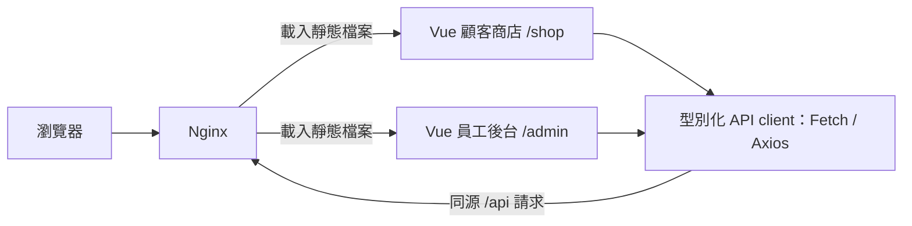

# Figura

*A Vue 3 and TypeScript storefront and staff console for a figure and collectibles shop.*

Figura 是面向公仔／收藏品單店的電商作品，提供顧客購物網站與員工管理後台（原名 ELPSY Shop）。
顧客可瀏覽商品、管理購物車並追蹤訂單；店員可處理商品、庫存、現貨與預購流程，集中核對交易狀態與異動紀錄。
本倉庫負責 Web 介面；[Spring Boot API](https://github.com/jackteng-dev/figura-api) 與 [Flutter App](https://github.com/jackteng-dev/figura-app) 各自獨立維護。

## 展示

- [線上沙盒 figura.jackteng.dev](https://figura.jackteng.dev)：可實際瀏覽商品、加入購物車、下單並模擬付款，也能用示範帳號進入員工後台（`/admin/login`）處理出貨與退貨。資料皆為虛構，每天 04:00（台北時間）自動重置。
  - 顧客：`demo_customer` / `figura-demo-customer`（也可自行註冊）
  - 店長：`shop_admin` / `figura-demo-admin`；員工：`shop_staff` / `figura-demo-staff`
- 沙盒與正式部署使用相同版本；為了讓每位訪客都能使用，停用員工／角色異動與商品圖片上傳。

## 主要功能

- 顧客註冊、登入、暱稱編輯、購物車與本人收件地址管理。
- 商品列表與詳情、多 SKU、品牌／作品／分類；後台草稿編輯、上架／下架、封存與商品主圖管理。
- SKU 庫存調整、實體／保留／可售數量查閱，以及附原因與操作者的異動紀錄。
- 現貨結帳、本人訂單、取消與逾時保留釋放；模擬付款、配送、全額退款、整筆退貨及異常付款核對。
- 整筆預購：批次與供應配額、截止時間、下單保留、模擬付款／退款、到貨登記、整筆分配與模擬配送。
- 員工、角色、固定權限與稽核管理；通知 outbox 查詢、模擬派送與失敗重排。

## 技術架構

| 層 | 技術 |
| --- | --- |
| 介面 | Vue 3、TypeScript、Element Plus、Bootstrap |
| 路由與狀態 | Vue Router、Pinia |
| API 通訊 | Axios／Fetch、同源 Cookie、CSRF token |
| 型別與建置 | vue-tsc、Vite、npm lockfile |
| Web 執行環境 | Nginx 靜態網站與 API 反向代理；本機使用 Vite preview |



圖中 Vue 與 API client 執行於瀏覽器；Nginx 設定與映像封裝由 [發布腳本](scripts/showcase-publish.py) 產生。
`/api` 由代理轉送至獨立 API 服務，後端與資料服務的部署不在本倉庫；本機代理設定見 [vite.config.ts](vite.config.ts)。

## 工程重點

- **處理結果未知的寫入**：預購下單與後台操作保留原 UUID／內容、凍結表單，以同一操作重試；收到成功回覆後若讀取失敗，只重新讀取，避免再次提交。[預購合約](docs/PREORDERS_API.md)
- **版本衝突與人工核對**：編輯帶入原版本，遇到 409 保留未送內容，要求重讀後明確重新操作，避免覆寫他人的修改。[存取治理合約](docs/STAFF_ACCESS_API.md)
- **顧客與員工入口隔離**：分開管理狀態、登入入口與 API；路由依固定權限碼載入後台元件，寫入帶 CSRF token，授權仍由後端核對。[路由](src/router/index.ts)、[顧客通訊](src/api/customer.ts)、[員工通訊](src/api/api.ts)
- **現貨與預購供應分離**：預購使用獨立批次、配額與付款介面，呈現到貨／分配／配送進度；現貨庫存與預購供應各自核對，防止混用。[預購合約](docs/PREORDERS_API.md)
- **主圖寫入與回應遺失處理**：限草稿操作，帶商品版本；結果未知時保留原檔案與 UUID 重試，成功後核對目前圖片與稽核。[圖片面板](src/views/catalog/ImagePanel.vue)

## 品質與交付

- GitHub Actions 的 [`verify`](.github/workflows/showcase-verify.yml) 對 PR 與 main 執行驗證；本 Web 專案由 [CI 腳本](scripts/homelab-ci.py) 執行 `npm ci` 與 `npm run build`，包含 vue-tsc 型別檢查及 Vite production build。
- 倉庫提供 [員工](scripts/smoke_browser.cjs)、[現貨訂單](scripts/smoke_orders_browser.cjs)、[預購履約](scripts/smoke_preorder_fulfillment_browser.cjs) 等 Playwright 瀏覽器 smoke 腳本，需後端與隔離資料環境，未納入上述 Web `verify`。
- 交付流程為 PR → CI 通過 → 合併 main → [私有 GHCR 映像發布](.github/workflows/homelab-release.yml) → 擁有者自架伺服器定期拉取的 CD；Web／API 配對部署。[交接文件](docs/HANDOFF.md) 記錄部署驗證與待辦，本次文件改寫未重新驗證遠端 CI 或部署。

## 本機啟動

先依 [新機啟動文件](docs/NEW_MACHINE_SETUP.md) 啟動獨立後端與全新隔離 demo 資料庫，準備自己的展示帳密，再於本倉庫執行：

```sh
npm ci
npm run build
VITE_API_PROXY_TARGET=http://127.0.0.1:19092/figura npm run preview -- --host 127.0.0.1 --port 15176 --strictPort
```

瀏覽 `http://127.0.0.1:15176/shop`，員工入口為 `/admin/login`。
`VITE_*` 僅放公開代理位址；私有帳密與金鑰不可放入前端。Vite preview 用於本機驗證。

## 已知限制

- 付款、退款、物流與通知均為模擬，不實際收款、轉帳、託運或寄送真人訊息；運費 0 僅供展示。
- 本作品用於開發與展示，尚未完成正式營運驗收；真實服務、商家政策、會員安全與負載驗收仍有待辦。[待驗收清單](docs/CLOUD_LOCAL_FOLLOWUP.md)
- 目前採單機起步，未完成多機容錯驗收；商品目前僅支援一張主圖。
- 待核對操作僅保存在頁面記憶體，重整後須先查訂單或稽核；部分退款、訂金尾款、延期與到貨後預購退貨尚未實作。

## 文件

- [新機啟動與測試環境](docs/NEW_MACHINE_SETUP.md)
- [目前進度與後續範圍](docs/ROADMAP.md)、[交接與歷史驗證結果](docs/HANDOFF.md)
- [商品合約](docs/CATALOG_API.md)、[主檔合約](docs/MASTERS_API.md)、[員工存取治理](docs/STAFF_ACCESS_API.md)
- [預購合約](docs/PREORDERS_API.md)、[通知 outbox 合約](docs/NOTIFICATIONS_API.md)
- [正式營運待驗收項目](docs/CLOUD_LOCAL_FOLLOWUP.md)
- [原 README 完整開發紀錄](docs/DEV_LOG.md)
